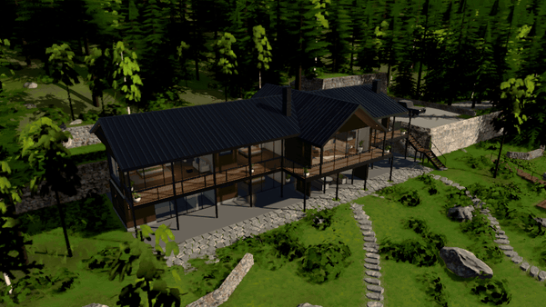

# Two floor plans, one house you can walk through

An experiment: I had two floor plans and a few still renders of the house, and wanted to see how close a browser
could get to those renders in real time, with a house you can walk into.

[](https://re4mat-mp.github.io/casa-3d/)

**▶ [Open the house and walk around it](https://re4mat-mp.github.io/casa-3d/v2/)** · [the start page](https://re4mat-mp.github.io/casa-3d/) · [the build manual](https://re4mat-mp.github.io/casa-3d/obra/) · [the first draft](https://re4mat-mp.github.io/casa-3d/v1/)

It didn't start from zero. The plans came together with three photorealistic still renders of the house
(not included here: they are someone else's work). Every wall in the 3D model was read off the two floor plans, at
1:50, with their dimension lines; the look (dark wood, black roof, the lake, the stone walls, golden-hour light) was
aimed at those renders. What neither of them says (the height of the floors, the roof pitch, the stair, the
furniture) is invented and listed as invented. The result runs in the browser with no install: you can orbit it, double-click a
floor and walk through the rooms, and drag the time of day to watch the light move. The pages are in Spanish.

> **In three sentences.** A first draft measured the plans into one HTML file of plain geometry and walking physics;
> the second version kept those coordinates as the contract and rebuilt everything around them. The house and the
> landscape were built in parallel by two Claude Code agents, each owning one module, against a written
> spec whose target was the reference renders. Nothing counted as done until it had been rendered in headless Chrome and the pictures
> looked right, because a 3D scene that "loads without errors" can still be a black screen.

## What's in it

| Page | What it is |
|---|---|
| [`v2/`](v2/) | **The house.** three.js r186 with WebGPU, falling back to WebGL2. Four stages: the plan on the ground → walls drawn as lines → a clay model → finished. Orbit, walk, time of day. |
| [`obra/`](obra/) | **A build manual**, 11 steps from the ground to the roof, with the quantities (m, m²) computed from the same geometry, not typed. |
| [`v1/`](v1/) | **The first draft.** One HTML file, three.js r160, plain materials. Where every coordinate was first measured. |
| [`v2/assets/`](v2/assets/) | The two floor plans it all comes from. |

## The method, in one screen

1. **Measure once, then never move a wall.** v1 turned the plans into coordinates (metres, x across the plan, z down
   it). v2 imports them unchanged; a self-test walks the house and checks the walls and floors (`?selftest`).
2. **Write the guesses down.** Floor height 2.70 m, roof pitch, a U-shaped stair, footings, furniture, the exact
   terrain. They are on the page, so nobody mistakes an invention for the plan.
3. **A spec before the builders.** The three reference renders became one file that says what makes them look real
   (materials, light, railings, nature) as a checklist, plus the coordinate system and the contract each module
   exports. The builders compared their screenshots against the renders. → `house.js`, `nature.js`
4. **Split by module, build in parallel.** One agent builds the house, another the landscape, the main session
   owns the engine (`main.js`) and `shared.js`. No two writers touch the same file.
5. **Every view is a URL.** `?stage=` `?hour=` `?view=` `?webgl` `?q=media` `?cycle` `?stats`, so a headless browser
   can open any state and take a picture of it.
6. **Look at it before calling it done.** Each change was rendered in headless Chrome, on both backends, desktop and
   phone width, and the screenshots were read. The GIF above came out of the same harness.
7. **Free assets only.** Textures, sky HDRIs, furniture and plants are CC0 from [Poly Haven](https://polyhaven.com),
   loaded at runtime.

## Mistakes included

- **The page stuck at 3 % in an embedded browser.** `navigator.gpu.requestAdapter()` never answered there. Now it
  waits 4 seconds and falls back to WebGL2 on its own.
- **On a phone the menu covered half the house.** Under 600 px it starts minimised.
- **The first load is slow:** about 25 MB of textures and models, plus shader compilation (around 10–30 s cold).
  After that it is smooth. If it stutters, switch quality to *Media*.
- **Known rough edges, left on purpose:** tree shadows are baked in, room labels overlap in plan view, and the dining
  chairs are classic because there are no modern ones in the free library. The aim was the right proportions,
  not polished materials.

## Run it locally

```bash
git clone https://github.com/re4mat-mp/casa-3d && cd casa-3d
python3 -m http.server 8798
```

Then open <http://localhost:8798/v2/>. No build step: ES modules and an import map, three.js from a CDN.
